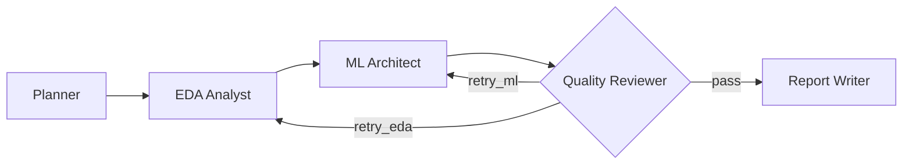

**TL;DR:** A reviewer agent did not make our data science pipeline more accurate. It made it safer. It found every impossible value we planted. It flagged a leaked column in 10 of 10 runs, where the other systems, AutoGluon included, reported a perfect score of 1.0 that meant nothing. The honest score was 0.65. It also dropped a real leak in the taxi data that we had not planted. The agent is not smarter. It is more careful.

<!-- more -->

Our multi-agent pipeline beat AutoGluon at predicting heart disease, 88% F1 against 73%. We were ready to write it up as a win.

Then we looked at the test set. It had 61 rows. The two systems had used different splits, and we had picked the winning model by F1 on that same test set. The win was not real, and we had to rerun the whole project to find out what was.

## Why this matters

This matters because agent frameworks promise reliability, and most write-ups prove it with one impressive score. A score tells you how a system did on one dataset on one day. Reliability is different. It means the system notices when something is wrong with its inputs and says so before it reports a number you might act on. That second property is what we set out to measure, and it turned out to be harder to measure than accuracy.

## What we tested

The question: does an AI pipeline with a built-in quality checker give more reliable results than a plain one-pass pipeline, especially when the data is messy?

We built the pipeline as a [LangGraph](https://www.langchain.com/langgraph) graph with five steps: plan, explore the data, train models, review, write a report. The review step is the interesting one. It checks the work and can send the graph back to an earlier step instead of moving on.

We compared it with a single-pass version, with [AutoGluon](https://auto.gluon.ai), and with a model that predicts "yes" for everyone. AutoGluon ran with a 60 second limit and the medium quality preset. Every fit finished in under 31 seconds, and a 300 second limit gave identical scores. Every system got the same train/test split, the same corrupted training data and the same clean test set, on three datasets:

- **Heart disease:** the [Cleveland data](https://archive.ics.uci.edu/dataset/45/heart+disease), 303 patients. Tiny and easy to overfit.
- **NYC taxi tips:** a sample of [yellow cab trips](https://www.nyc.gov/site/tlc/about/tlc-trip-record-data.page). Whether a ride was tipped.
- **Amazon Beauty reviews:** a sample of [Amazon reviews](https://amazon-reviews-2023.github.io/). Whether a review is positive.

Then we damaged the training data on purpose: random wrong labels (5%, 15% and 30%), impossible values like an age of -9999, and one fake column that leaks the answer. The test data always stayed clean.

## How the pipeline works

Each of the five steps has one job.

- **Planner:** looks at the data and writes down the risks, such as unbalanced classes or missing values. A language model can add a one-line plan, but nothing depends on it.
- **EDA analyst:** fills in missing values using the training rows only, then applies any fixes the reviewer asks for, such as dropping a row or a column.
- **ML architect:** tries three standard models (random forest, logistic regression and gradient boosting), picks the best one by cross-validated MCC on the training data, and scores it on the held-out test set.
- **Quality reviewer:** the checker. It decides whether the result can be trusted and, if not, where to send the graph back to.
- **Report writer:** records the plan, what was fixed, the metrics and the full log.

In one line: Planner → EDA Analyst → ML Architect → Quality Reviewer → Report Writer, where the reviewer can send the graph back to the EDA Analyst or the ML Architect.

The two arrows that go back are the point. A plain pipeline runs once and reports whatever comes out. This one can stop, fix the data and try again, up to three times.

**What the reviewer checks**

1. **Impossible values.** An age of -9999 or a negative fare. The reviewer has hand-written limits for each dataset, and it sends the graph back to drop those rows.
2. **A leaked feature.** One column that almost gives away the answer on its own. If dropping a single column makes a suspiciously high score collapse, that column is the leak.
3. **Wrong labels.** Rows where a model trained on the rest of the data strongly disagrees with the given label.
4. **A model that just says yes.** If almost every prediction is positive, or recall and specificity are badly lopsided, the reviewer retries with class weights, a tuned threshold or a different model.

If a retry changes nothing, the graph stops and says so instead of looping.

## Why our first result was wrong

Three things went wrong at once:

- **Different splits and models.** Each system got its own train/test split and its own models, so a score gap could come from anywhere.
- **A 61-row test set.** One extra correct prediction moves the score by about 1.6 points.
- **F1 as the judge.** F1 rewards a model that says "positive" for everyone, and we were also choosing models by F1 on the test set.

The F1 problem is the easiest to see. About 80% of NYC taxi rides are tipped, so a model that always answers "tipped" looks great:

| System (NYC taxi) | F1 | MCC |
|---|---|---|
| Always answers "tipped" | 0.889 | 0.000 |
| Real model | 0.894 | 0.202 |

By F1 they are nearly tied. By [MCC](https://en.wikipedia.org/wiki/Phi_coefficient), a score where 0 means guessing and 1 means perfect, the do-nothing model gets exactly 0. So we rebuilt the benchmark with one split for every system, models chosen only on training data, seeded corruption, many random seeds, and MCC as the main score.

## What the fair test shows

On accuracy, nobody clearly wins. Here are all three systems side by side, scored with MCC on the clean test set and averaged over random splits (10 for heart disease, 5 or 6 for Amazon, 3 for taxi). "LangGraph + reviewer" is our rebuilt multi-agent pipeline:

| Dataset | Wrong labels in training data | AutoGluon | Single pass | LangGraph + reviewer |
|---|---|---|---|---|
| Heart disease | 0% | 0.642 | 0.646 | 0.650 |
| Heart disease | 5% | 0.623 | 0.654 | 0.654 |
| Heart disease | 15% | 0.605 | 0.651 | 0.628 |
| Heart disease | 30% | 0.468 | 0.504 | 0.466 |
| Amazon reviews | 0% | 0.590 | 0.591 | 0.591 |
| Amazon reviews | 5% | 0.593 | 0.581 | 0.578 |
| Amazon reviews | 15% | 0.573 | 0.549 | 0.550 |
| Amazon reviews | 30% | 0.517 | 0.519 | 0.517 |
| NYC taxi tips | 0% | 0.094 | 0.202 | 0.129 |
| NYC taxi tips | 5% | 0.093 | 0.206 | 0.156 |
| NYC taxi tips | 15% | 0.118 | 0.206 | 0.157 |
| NYC taxi tips | 30% | 0.046 | 0.206 | 0.130 |

**How to read the table.**

- **Heart disease: a tie.** The three systems are within a few hundredths of each other at every noise level. The score moves by about 0.1 from one random split to the next, so gaps this small are noise. All three also fall as more labels go wrong, and the fall is steepest at 30%.
- **Amazon reviews: also a tie.** The reviewer and the single pass score the same at every noise level. The only gap outside the noise is AutoGluon at 15% wrong labels, 0.024 higher, which is small.
- **NYC taxi tips: AutoGluon is lowest at every noise level**, by 0.09 to 0.16 MCC, and that gap is outside the noise. Taxi is a hard task (every MCC is 0.2 or below) and we only ran 3 splits, so treat the size of the gap with care. The ordering is the same at every noise level, though.
- **The reviewer costs a little on taxi.** Compared with the single pass it is lower on clean data (0.07 MCC), and within the noise at the other levels. Its retry step pushes the model toward a more balanced one. On clean data the single pass says "tipped" for almost every ride (recall 1.00, specificity 0.055), which is why its F1 matches the do-nothing model. The reviewer's model catches more of the untipped rides (specificity 0.353, recall 0.785). That raised balanced accuracy (0.569 against 0.527) but lowered MCC and F1.
- **Nothing here says the multi-agent system is more accurate.** If you only wanted the best score, the single pass is as good or better everywhere.

Here is the same comparison for heart disease, split by reviewer version:

| Wrong labels in training data | Single pass | Reviewer (first version) | Reviewer (rebuilt) |
|---|---|---|---|
| 0% | 0.646 | 0.638 | 0.650 |
| 15% | 0.651 | 0.562 | 0.628 |
| 30% | 0.504 | 0.443 | 0.466 |

**How to read the chart.** On the left, the three systems score about the same when the data is clean or lightly damaged, and all of them drop when 30% of the labels are wrong. The first reviewer (orange) is lowest at 15% and 30% noise, because it deleted good rows. The rebuilt reviewer (blue) recovers most of that loss but does not beat the single pass (grey). On the right, a column that leaks the answer pushes the single pass to a perfect 1.00. AutoGluon also scored 1.00 in all 10 splits (not drawn). The reviewers flag the column and report 0.65, which is the honest score. The point of the reviewer is the right panel, not the left.

Our first reviewer made things worse. It deleted rows it thought were mislabeled, and with only about 240 training rows it threw away good data. We rebuilt it so it removes rows only if a leak-free cross-validation test shows that helps. That fixed most of the damage, but it still does not beat the single pass. On Amazon reviews all systems tie. On taxi tips the rebuilt reviewer scores lower on MCC, because it forces a more balanced model.

**Where the reviewer earns its place**

- **Impossible values:** it found all of them, on all three datasets.
- **Planted leaks:** with a fake leaked column added, the single pass, the plain graph and AutoGluon scored a perfect MCC of 1.0. The reviewer flagged the column in 10 of 10 runs and reported the true 0.65.
- **A natural leak:** it caught a real one. In the taxi data, the payment type almost gives away the tip, since cash tips are not recorded. With that column kept, the single pass, the plain graph, the first reviewer and AutoGluon all scored an MCC of about 0.91. The rebuilt reviewer dropped the column in 3 of 3 runs and reported about 0.09, close to the 0.13 it scores without the column. That is three runs on one dataset, so treat it as promising, not proven.

By default its routing is rule-based: the language model only writes the plan and the summary. We also let a small local model (llama3.2) pick the retry strategy instead of the fixed order. Over 12 taxi runs it ended up with exactly the same sequence as the rules every time, so it changed no scores. We did not record whether it gave its own answer or fell back to the rules, so we cannot say it made a real choice.

**A closer look at the label checks**

The reviewer could often spot suspicious labels. On the Amazon reviews, the rows it flagged were mislabeled about 60% of the time, and it found about 54% of the wrong labels we had planted. But removing the flagged rows never improved the final score. About 40% of what it flagged was fine, and the models cope with the rest well enough anyway. Spotting a problem and fixing it are two different skills.

Building the rebuilt check also taught us something about our own testing. Our first version of the "does removing rows help?" test looked great, even on clean data. It was fooled. The detector that picked the rows to drop had already seen the validation rows, so cleaning looked helpful when it was not. The fix was to repeat the whole detection step inside every cross-validation fold, so nothing from the validation rows leaks in. After that, on clean data the reviewer scored exactly the same as having no reviewer, which is the right answer.

## What to take from this

If you test an AI pipeline, a few habits would have saved us a rerun:

1. **Add a do-nothing baseline.** If "always yes" scores nearly as well, your metric is hiding something.
2. **Give every system the same split.** Choose models on training data only, and never on the test set.
3. **Plant faults and see who notices.** A pipeline that reports a perfect score on leaked data is the one to worry about.
4. **Report the null result.** "No accuracy gain, but it catches broken data" is less exciting than a win, and much more useful.

The limits are real. Heart disease used 10 random splits, Amazon 5 or 6 and taxi only 3, on 5,000-row samples. AutoGluon used only the medium quality preset. The leak we planted is easy to spot, and the natural leak check was tried on one dataset.

Next we want to test more splits on the taxi data, try AutoGluon's best quality preset, record the language model's raw answers when it picks a retry strategy, and test the natural leak check on more datasets.

The code, the results and a step-by-step write-up are in the [project folder](https://github.com/Under-the-stars/umd_classes/tree/research/fair-benchmark/research/agentic_benchmark). If you have run a similar comparison, or can see a flaw in ours, we would like to hear about it in the comments.
